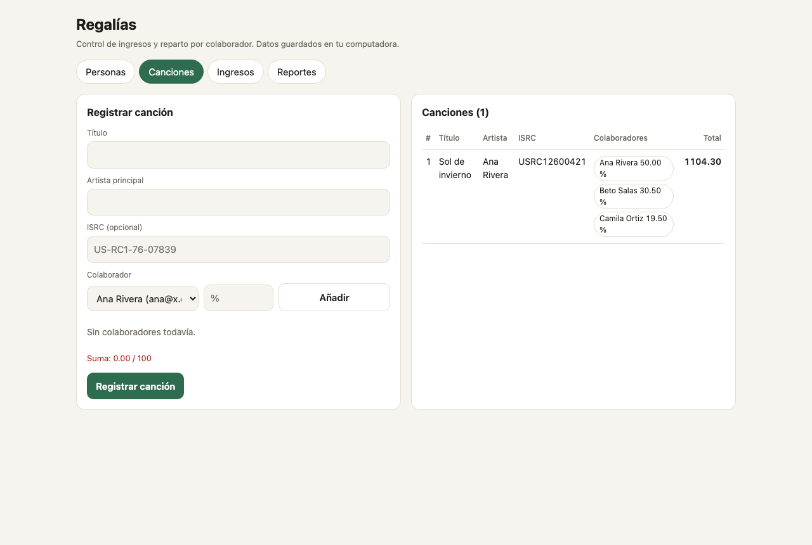
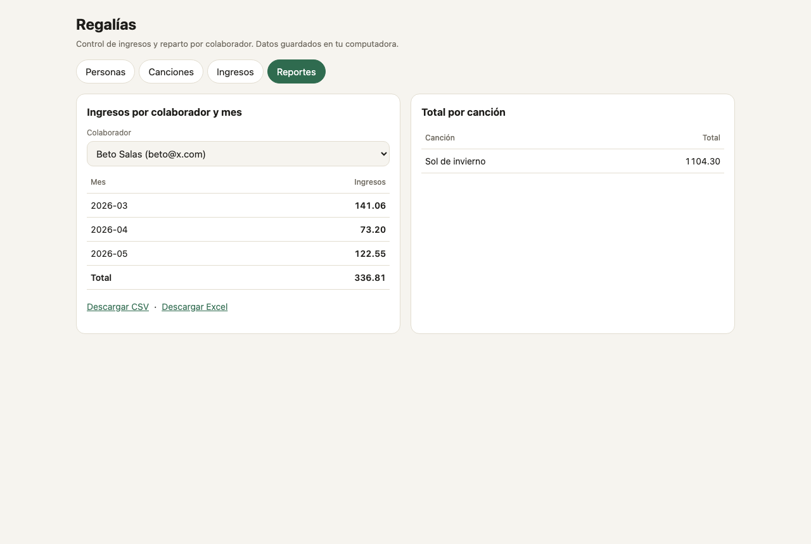
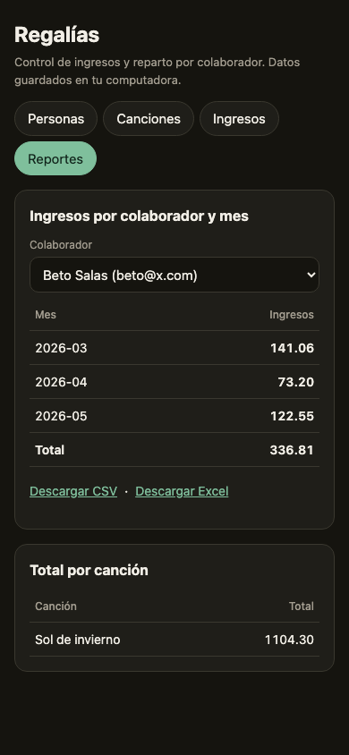

# Regalías

Herramienta para que artistas independientes registren canciones, colaboradores e
ingresos (reproducciones y ventas), y calculen cuánto le corresponde a cada persona según
el porcentaje acordado. Todo corre en tu computadora y los datos se guardan en un archivo
SQLite local.




## Características

- **Personas y canciones:** cada colaborador tiene un identificador único (correo o código) y cada canción
  reparte el 100 % entre sus colaboradores.
- **Ingresos:** registra reproducciones (cantidad × tarifa) o ventas (precio neto).
- **Reparto exacto:** los centavos nunca se pierden ni se inventan; cada ingreso se reparte al registrarse.
- **Reportes:** ingresos por colaborador y mes, y total por canción.
- **Exportación:** descarga el reporte de cada persona en CSV o Excel (`.xlsx`).
- **Interfaz web** en tu navegador, con modo oscuro y diseño adaptable a móvil.
- **Línea de comandos** para quien prefiere la terminal.

| Escritorio: reportes | Móvil, modo oscuro |
|---|---|
|  |  |

## Inicio rápido

Necesitas Python 3.9 o superior. No hay que instalar nada más.

```bash
git clone https://github.com/paultinoterronespuchuri1982/regalias.git
cd regalias
python3 -m regalias.web --db regalias.sqlite
```

Abre http://127.0.0.1:8765 en tu navegador.

Para pedir una clave de acceso, agrega `--clave` o define la variable `REGALIAS_CLAVE`.

### Línea de comandos

```bash
python3 -m regalias.cli persona --id ana@x.com --nombre Ana
python3 -m regalias.cli persona --id beto@x.com --nombre Beto

python3 -m regalias.cli cancion --titulo Sol --artista Ana \
    --isrc US-RC1-76-07839 --colaborador ana@x.com:50 --colaborador beto@x.com:50

python3 -m regalias.cli reproducciones --cancion 1 --fecha 2026-03-10 --cantidad 1000 --tarifa 0.0037
python3 -m regalias.cli venta --cancion 1 --fecha 2026-04-02 --precio 10.00

python3 -m regalias.cli reporte --colaborador beto@x.com
```

Todos los comandos aceptan `--db` para elegir el archivo de datos. Los errores de negocio
salen con código 1 y un mensaje que explica qué corregir.

### Con Docker

```bash
docker build -t regalias .
docker run --rm -p 127.0.0.1:8765:8765 -e REGALIAS_CLAVE="una-clave-larga" \
    -v regalias-datos:/data regalias
```

El contenedor escucha en todas sus interfaces, por eso exige `REGALIAS_CLAVE`. El puerto se
publica solo en `127.0.0.1`, así que solo tu computadora puede acceder.

## Reglas de negocio

- **Porcentajes:** entre 0 y 100, con máximo dos decimales. La suma de una canción debe ser exactamente 100.
- **Identificadores:** no distinguen mayúsculas ni espacios sobrantes. `ANA@x.com ` y `ana@x.com` son la misma persona.
- **Homónimos:** dos personas con el mismo nombre se separan por su identificador.
- **ISRC:** opcional. Se normaliza (sin guiones, en mayúsculas) y no puede repetirse.
- **Montos:** dos decimales con redondeo mitad hacia arriba. Las tarifas admiten hasta seis decimales.
- **Reparto:** cada persona recibe la parte entera en centavos. El centavo sobrante va a quien
  tenga el mayor residuo; en empate, al colaborador registrado primero. La suma repartida
  siempre iguala el monto del evento.
- **Valores no válidos:** se rechazan los negativos, `NaN`, `Infinity` y los flotantes.

## Arquitectura

```
regalias/
  dinero.py     Aritmética monetaria con Decimal y reparto exacto en centavos
  registro.py   Reglas de negocio: personas, canciones, ISRC e ingresos
  almacen.py    Persistencia en SQLite; cada ingreso y su reparto van en una transacción
  reportes.py   Consultas: ingresos por persona y mes, total por canción
  cli.py        Línea de comandos
  web.py        Servidor HTTP local: API JSON, descargas y archivos estáticos
  xlsx.py       Generador de .xlsx con la biblioteca estándar
  static/       Interfaz en HTML, CSS y JavaScript sin frameworks
tests/          Pruebas: reglas, almacén, CLI, servidor, navegador
docs/capturas/  Capturas de pantalla de la interfaz
```

Un ingreso sigue este camino: `cli.py` o `web.py` reciben los datos, `registro.py` los valida
y calcula el monto, `dinero.py` reparte el monto entre colaboradores, y `almacen.py` guarda el
ingreso y su reparto en una sola transacción. La capa de datos no decide reglas de negocio.

## Desarrollo

```bash
python3 -m venv .venv
.venv/bin/pip install -r requirements-dev.txt
.venv/bin/python -m playwright install chromium

.venv/bin/python -m pytest             # pruebas, incluida una en navegador real
.venv/bin/ruff check . && .venv/bin/ruff format --check .
.venv/bin/bandit -q -r regalias         # análisis de seguridad del código
.venv/bin/pip-audit                     # vulnerabilidades en dependencias
```

Las pruebas del navegador se omiten si Chromium no está instalado. La integración continua
en `.github/workflows/ci.yml` ejecuta todos estos pasos en cada cambio.

## Seguridad

Ver [SECURITY.md](SECURITY.md) para cómo reportar una vulnerabilidad. Resumen:

- El servidor escucha solo en `127.0.0.1` y rechaza peticiones con un `Host` que no sea local.
- Con clave configurada, la API exige `Authorization: Bearer <clave>` y compara en tiempo constante.
- Las escrituras exigen `application/json` y tienen un límite de 64 KB.
- Las respuestas incluyen una Content-Security-Policy estricta, `X-Frame-Options: DENY` y `nosniff`.
- Las consultas SQL usan parámetros, y el texto de la base de datos se escapa antes de mostrarlo.

## Limitaciones

- El archivo SQLite no está cifrado. Quien tenga acceso al archivo tiene acceso a los datos.
- Hay una sola clave para todo el servidor: no hay usuarios, roles ni registro de auditoría.
- Una persona con dos identificadores (por ejemplo, dos correos) aparece como dos personas.
- La exportación es a CSV y Excel. No hay PDF.
- El servidor atiende una petición a la vez. Está pensado para una persona.
- Las bases de datos creadas antes de los identificadores de persona no son compatibles.

## Contribuir

Lee [CONTRIBUTING.md](CONTRIBUTING.md) antes de abrir un pull request.

## Licencia

Pendiente de definir por el autor.
